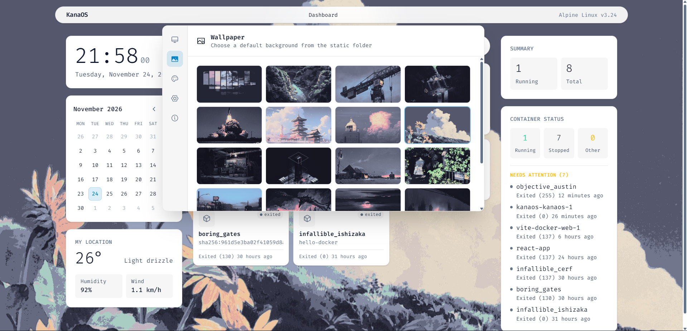
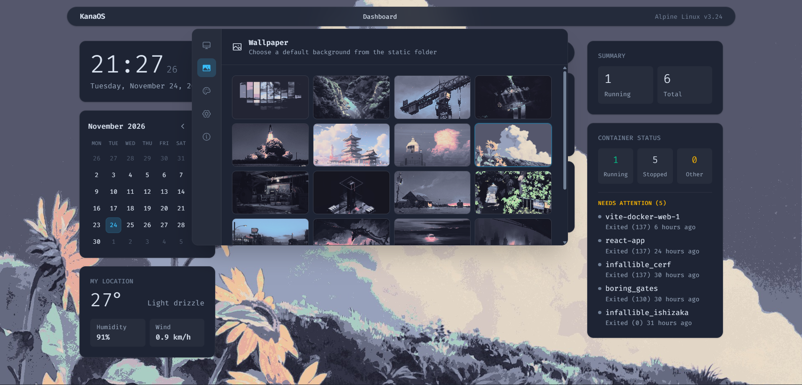
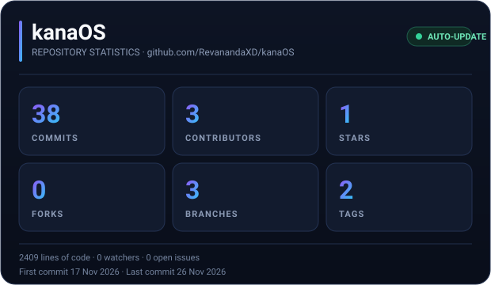

# kanaOS

<div align="center">
  

  <h1>kanaOS</h1>

  <p><strong>A simple, minimalist dashboard for self-hosted environments.</strong></p>

  <p>
    <a href="https://github.com/RevanandaXD/kanaOS/actions/workflows/ci.yml">
      
    </a>
    <a href="https://github.com/RevanandaXD/kanaOS/actions/workflows/docker.yml">
      
    </a>
    <a href="https://github.com/RevanandaXD/kanaOS/stargazers">
      
    </a>
    <a href="https://github.com/RevanandaXD/kanaOS/commits/main">
      
    </a>
    <a href="./LICENSE">
      
    </a>
  </p>

  <p>
    
    
  </p>
</div>

## Table of Contents

- [About](#about)
- [Features](#features)
- [Repository Statistics](#repository-statistics)
- [Tech Stack](#tech-stack)
- [Project Structure](#project-structure)
- [Getting Started](#getting-started)
- [Running with Docker](#running-with-docker)
- [Environment Variables](#environment-variables)
- [API Endpoints](#api-endpoints)
- [Contributing](#contributing)
- [License](#license)

## About

kanaOS is a lightweight, minimalist dashboard for monitoring system resources and Docker containers in self-hosted environments.

Built with SvelteKit on the frontend and a lightweight Go API on the backend, kanaOS provides real-time system insights through a single, self-contained Docker container.

Designed for home servers and self-hosting enthusiasts who want a clean, straightforward way to monitor their infrastructure without the overhead of a complex dashboard.

## Features

- **Real-time Docker Monitoring** — View Docker containers, their running states (`running`, `stopped`, or `other`), health checks, and container statistics with automatic updates every 5 seconds.
- **System Monitoring** — Monitor operating system, hostname, kernel version, architecture, uptime, CPU usage, memory, and disk utilization through the `/api/system` endpoint.
- **Dashboard Widgets** — Built-in clock, calendar, and weather widgets powered by Open-Meteo, with configurable coordinates.
- **Light & Dark Themes** — Switch between light and dark modes, customize wallpapers, and keep your preferences saved locally in the browser.
- **Lightweight Deployment** — Frontend and backend run together in a single container and are exposed through a single port.
- **Automated CI** — GitHub Actions runs formatting checks, static analysis, tests, and production builds for both frontend and backend.
- **Automated Repository Statistics** — Automatically generated repository statistics, updated on every push and daily.

## Repository Statistics

<p align="center">
  
</p>

The statistics card displays the total number of **commits, contributors, stars, forks, branches, tags, lines of code**, as well as the dates of the first and latest commits.

The `public/stats.svg` file is generated by [`scripts/generate-stats.sh`](./scripts/generate-stats.sh) and automatically committed through [`.github/workflows/stats.yml`](./.github/workflows/stats.yml).

- **Triggers:** Pushes to `main` and a daily schedule at 03:23 UTC. Manual execution is also available through `workflow_dispatch`.
- **Data sources:** Git history (`git rev-list`, `git shortlog`, branches, and tags) for repository metrics, and the GitHub REST API via `gh` for stars, forks, watchers, and open issues.
- **Loop prevention:** Workflow-generated commits use `[skip ci]`, bot actors are ignored, and changes to `public/stats.svg` do not trigger another statistics update.

The badges at the top of this README are also dynamic. They retrieve repository information directly from GitHub through Shields.io rather than displaying hardcoded values.

To regenerate the statistics card manually:

```bash
bash scripts/generate-stats.sh

# Specify a custom output path
bash scripts/generate-stats.sh public/stats.svg

# Optionally override GitHub metrics without gh or a token
STARS=12 FORKS=3 WATCHERS=1 OPEN_ISSUES=0 bash scripts/generate-stats.sh
```

> Commit statistics are calculated from the entire Git history using `git rev-list --count HEAD`. Make sure to use `fetch-depth: 0` when checking out the repository in GitHub Actions.

## Tech Stack

| Component | Technology |
| --- | --- |
| Frontend | SvelteKit 3, Svelte 5 (Runes), TypeScript, Tailwind CSS 4, Vite 8, Phosphor Icons |
| Backend | Go 1.27, `net/http`, Docker Client (`github.com/moby/moby/client`) |
| Build & Deployment | pnpm 12, Node.js 26, Docker Multi-stage Build, GitHub Container Registry |
| Automation | GitHub Actions (CI, Docker, Repository Statistics) |

## Project Structure

```text
kanaOS/
├── app/
│   ├── client/              # SvelteKit frontend
│   │   └── src/
│   │       ├── api/         # API fetch helpers
│   │       ├── components/  # Dashboard widgets and UI components
│   │       └── routes/      # Dashboard pages, layouts, and themes
│   └── server/              # Go API backend
│       └── internal/
│           ├── api/         # HTTP router and handlers
│           ├── config/      # Configuration loader
│           ├── docker/      # Docker client, caching, and data mapping
│           └── system/      # Platform-specific system information
├── public/                  # Logo, screenshots, and generated statistics
├── scripts/                 # Repository statistics generator
└── .github/
    └── workflows/           # CI, Docker, and statistics workflows
```

## Getting Started

### Prerequisites

- Node.js 26
- pnpm 12
- Go 1.27
- Docker Engine with an accessible Docker socket
- Git Bash or a POSIX-compatible shell for running the statistics script

### Clone the Repository

```bash
git clone https://github.com/RevanandaXD/kanaOS.git
cd kanaOS
```

### Run the Frontend

Open the first terminal:

```bash
cd app/client
pnpm install
pnpm dev
```

The frontend will be available at `http://localhost:3000` (or the port reported by Vite).

### Run the Backend

Open a second terminal:

```bash
cd app/server
go run ./cmd/kanaos
```

The API will be available at `http://localhost:8080`.

During local development, the frontend uses relative `/api/...` requests, while the Go backend proxies frontend requests to `http://127.0.0.1:3000`.

### Run Checks Before Committing

Frontend:

```bash
cd app/client
pnpm check
pnpm lint
pnpm build
```

Backend:

```bash
cd app/server
gofmt -l .
go vet ./...
go test ./...
go build ./...
```

## Running with Docker

The easiest way to run kanaOS is through Docker Compose using the prebuilt image from GitHub Container Registry:

```bash
docker compose up -d
```

Alternatively, build the image locally:

```bash
docker compose up -d --build
```

Once the container is running, open:

`http://localhost:3000`

Docker Compose mounts the Docker socket in read-only mode to allow the backend to retrieve container information.

## Environment Variables

The following environment variables are optional:

| Variable | Default | Description |
| --- | --- | --- |
| `PORT` | `8080` | API and container listening port |
| `WEB_UPSTREAM` | `http://127.0.0.1:3000` | Upstream URL for the SvelteKit frontend |
| `DOCKER_CACHE_TTL` | `3s` | Cache duration for Docker container listings |

## API Endpoints

| Method | Endpoint | Description |
| --- | --- | --- |
| `GET` | `/api/health` | API health check |
| `GET` | `/api/containers` | Retrieve Docker containers, including their status and health information |
| `GET` | `/api/system` | Retrieve system information, including OS, hostname, kernel, architecture, uptime, CPU, memory, and disk usage |
| `GET` | `/*` | Reverse proxy to the SvelteKit frontend |

Example requests:

```bash
curl http://localhost:8080/api/health
curl http://localhost:8080/api/containers
curl http://localhost:8080/api/system
```

## Contributing

Contributions are welcome!

1. Fork the repository and create a new branch from `main`, such as `feat/feature-name`.
2. Follow the existing commit message conventions: `feat(...)`, `fix(...)`, `refactor(...)`, and `chore(...)`.
3. Ensure all checks pass, including `pnpm check`, `pnpm build`, `gofmt`, `go vet`, and `go test`.
4. Submit a pull request with a clear description of your changes.

Repository statistics are generated automatically, so there is no need to edit `public/stats.svg` manually.

## License

This project is licensed under the [GNU General Public License v3.0](./LICENSE).

Copyright © Revananda.
